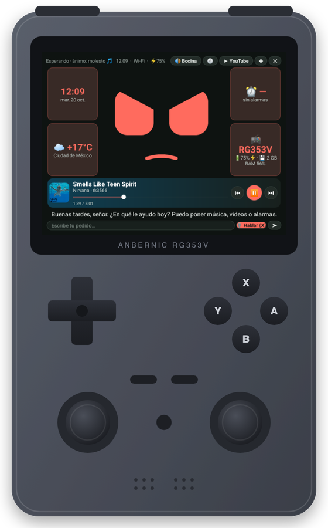
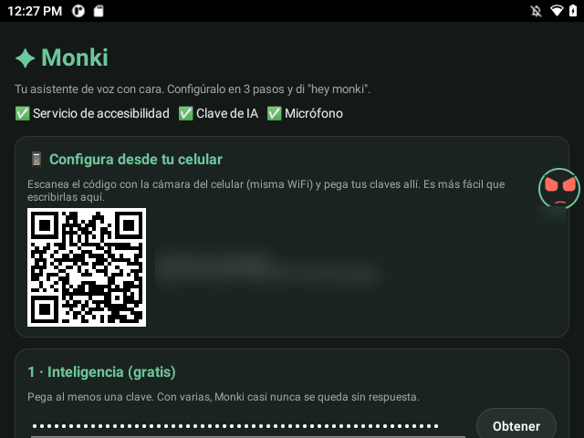
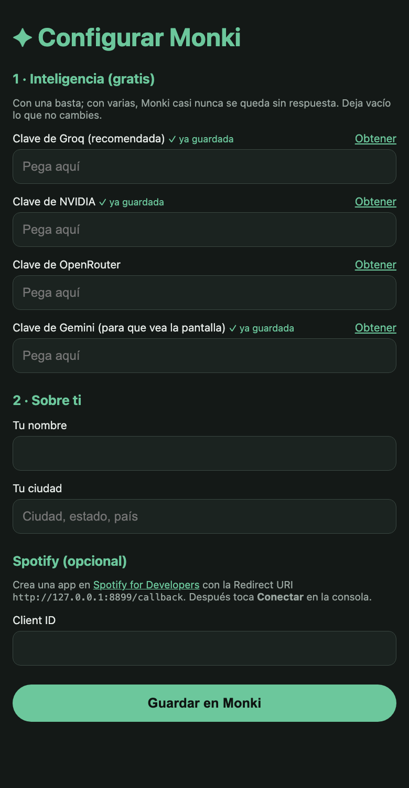
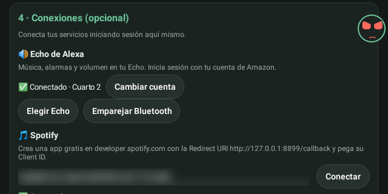
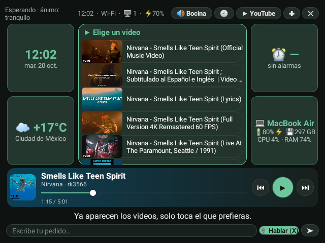
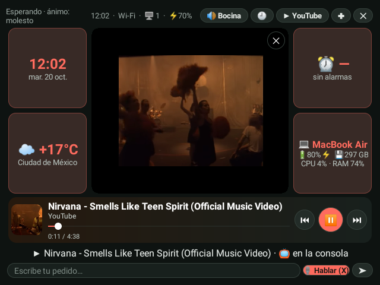

<div align="center">

# Monki

### Asistente de voz con cara para la consola Anbernic RG353V

Lo despiertas con *"hey monki"*, te entiende en español y **actúa**: contesta, busca en internet, maneja la consola,
pone música y alarmas en tu Echo y reproduce YouTube en su propia pantalla.

[](https://github.com/Niicko12/monki/releases/latest)


[Instalar](#instalar-en-3-pasos) ·
[Funciones](#funciones) ·
[Galería](#galería) ·
[Uso](#uso) ·
[Cómo funciona](#cómo-funciona)

</div>

---

## Por qué Monki

- **Gratis.** Usa APIs gratuitas en cadena (Groq → NVIDIA → OpenRouter → Gemini). Si se agotan o no hay internet,
  contesta con un modelo que corre **dentro de la consola**.
- **Todo en la consola.** No necesita ninguna computadora ni servidor: instalas la app y listo.
- **Tiene personalidad.** Cara animada con boca que sigue la voz y un ánimo que cambia con la conversación, la hora, la
  batería y la música o el video que suena. Ese ánimo tiñe toda la interfaz.
- **Hecho para un control.** Se usa con la cruceta y los botones, o tocando la pantalla.


---

## La consola



Monki está hecho y probado en la **Anbernic RG353V**, una consola portátil vertical con Android. Funciona en otras
consolas o tabletas con Android 11 o más reciente, con micrófono y WiFi.

| | Anbernic RG353V |
|---|---|
| Procesador | Rockchip RK3566, 4 núcleos Cortex-A55 a 1.8 GHz, GPU Mali-G52 |
| Memoria | 2 GB de RAM, 32 GB internos y dos ranuras microSD |
| Pantalla | 3.5" IPS táctil de 640 × 480 (Monki está diseñado para esta resolución) |
| Conexión | WiFi 2.4/5 GHz y Bluetooth 4.2 |
| Batería | 3500 mAh |
| Sistema | Android 11 |

**Controles en Monki:**

| Botón | Acción |
|---|---|
| **X** | Hablar |
| **B** | Interrumpir, cerrar el video o el detalle |
| **A** | Elegir |
| Cruceta | Moverse entre widgets, videos, canciones y botones |
| Volumen | Volumen del Echo o de la consola, según dónde suene |

<sub>Ilustración propia; la pantalla es una captura real de Monki.</sub>

<br clear="right">
---

## Instalar en 3 pasos



1. **Descarga** `Monki.apk` desde [Releases](https://github.com/Niicko12/monki/releases/latest) e instálalo en la consola
   (ábrelo desde el administrador de archivos y permite "instalar apps desconocidas").
2. **Abre Monki** y sigue la pantalla de configuración:
   - **Escanea el código QR con tu celular** (misma WiFi): se abre un formulario donde pegas tus claves cómodamente.
     El botón **Obtener** junto a cada una abre la página para crearla gratis; con
     [Groq](https://console.groq.com/keys) basta. Escribe también tu nombre y tu ciudad.
   - En la consola, toca **Activar accesibilidad** y **Permitir micrófono**.
3. Di ***"hey monki"***.

Para usar tu Echo, Spotify o el modo sin internet, ve a [Conexiones](#conexiones).

<br clear="right">


---

## Configuración

Todo se configura en la pantalla de la app. Nada requiere computadora ni cables.

### Desde el celular



Escribir claves largas con el teclado de la consola es tedioso. Por eso la pantalla de configuración muestra un
**código QR**: escanéalo con la cámara del celular (conectado a la misma WiFi) y se abre este formulario.

- **Claves de IA:** pega una o varias. **Obtener** abre la página para crear cada una gratis.
- **Tu nombre y tu ciudad:** para saludarte y darte el clima.
- **Client ID de Spotify:** si quieres usar Spotify.
- Un campo vacío no borra lo que ya estaba guardado; junto a cada clave ves si ya hay una.

El formulario lo sirve la propia consola **solo mientras la pantalla de configuración está abierta**, y pide una clave
aleatoria que va dentro del QR: nadie más en tu red puede cambiar tus datos.

<br clear="right">

### Conexiones

<p align="center">
  
</p>

| Conexión | Cómo se conecta | Para qué |
|---|---|---|
| **Echo de Alexa** | **Iniciar sesión** abre Amazon dentro de Monki. Luego **Elegir Echo** | Música, alarmas con Spotify y volumen en tu Echo |
| **Bluetooth del Echo** | **Emparejar Bluetooth**, una sola vez | Botón **🔊 Bocina**: el audio de la consola sale por el Echo |
| **Spotify** | Client ID de una app gratis de [Spotify for Developers](https://developer.spotify.com/dashboard) (Redirect URI `http://127.0.0.1:8899/callback`) y **Conectar** | Reproductor, lista de canciones y pasar la música entre el Echo y la consola |
| **Sin internet** | **Descargar** (≈ 430 MB) | Contestar sin red o cuando se acaban las cuotas |

### Opciones avanzadas

Ocultas por defecto, en **Mostrar opciones avanzadas**:

| Opción | Qué hace |
|---|---|
| Personalidad | Cómo habla Monki (por defecto, mayordomo educado con humor seco) |
| Color | `ánimo` (cambia con el ánimo y lo que suena) o uno fijo: verde, azul, cian, morado, rosa, rojo, naranja, amarillo, blanco o `#RRGGBB` |
| Palabra de activación | La palabra que lo despierta (por defecto *monkey*, que suena como "monki") |
| Voz | Voz de Gemini (Charon, Orus, Kore, Puck…) |
| Siempre escuchando | Mantiene el oído atento a la palabra de activación |
| Responder en voz alta | Si lo apagas, solo contesta en pantalla |
| Burbuja flotante | Burbuja con la cara para abrir Monki desde cualquier app |
| Control por MCP | Permite que otros agentes de tu red manejen la consola (muestra dirección y clave) |

Todos los ajustes también se pueden poner por adb: ver [Configuración](docs/configuracion.md).
---

## Funciones

| Área | Qué puedes pedirle |
|---|---|
| **Conversar** | Cualquier pregunta, en 1 o 2 frases directas. Personalidad de mayordomo con humor seco |
| **Internet** | Búsquedas, leer páginas y clima, sin gastar cuota de IA |
| **Música** | *"Pon música relajante en Spotify"*, pausa, siguiente, volumen, adelantar. Suena en el Echo o en la consola |
| **YouTube** | *"Pon en YouTube…"*: lista con miniaturas para elegir y reproductor en el lugar de la cara |
| **Alarmas en el Echo** | *"Pon una alarma mañana a las 7 con Metallica"*: suena en el Echo con esa música de Spotify |
| **Tiempo y memoria** | Temporizadores, recordatorios y datos tuyos que recuerda entre conversaciones |
| **Rutinas** | Frases que hacen varias cosas (*"buenas noches"*). Se crean y se borran hablando |
| **La consola** | Ve la pantalla, toca, desliza, abre apps y juegos, escribe, volumen, brillo y batería |

### La cara

- **Ojos y boca animados** con 20 expresiones; la boca se mueve con el volumen real de la voz.
- **Se siente viva:** respira, tiene destello en los ojos, rebota al cambiar de expresión, parpadea, muestra puntitos al
  pensar y "z" al dormir.
- **Ánimo persistente:** sube con respuestas alegres, baja con tristes, se cansa de noche o con poca batería y se aburre
  si no le hablas.
- **Ánimo de lo que suena:** al cambiar la canción o abrir un video decide si es bailable, alegre, tranquilo, triste o
  pesado. La cara, los widgets, los botones y el reproductor toman ese color.

<p align="center">
  
  <br><sub>Feliz, emocionado, triste, molesto, cansado y aburrido.</sub>
</p>

### La pantalla

- **Widgets** a los lados de la cara: hora, clima, próxima alarma y la consola (batería, almacenamiento, RAM). Tócalos
  para ver el detalle; regresa sola a la cara en 10 s.
- **Reproductor** con portada, fondo del color de la portada, **barra que se arrastra** y botones ⏮ ⏯ ⏭. Aparece cuando
  suena Spotify y se oculta tras un minuto en pausa. Tócalo para ver la lista de canciones y elegir otra.
- **Con un video abierto, el reproductor controla el video:** ⏯ pausa, ⏮ ⏭ saltan 10 s y la barra recorre el video.
- **Una sola cosa suena a la vez:** abrir un video pausa Spotify, y darle play a Spotify pausa el video.

### Por dónde suena

<p align="center">
  
</p>

- **📺 Consola / 🔊 Bocina** cambia la salida de audio de un toque, **sin cortar** la música ni el video.
- **Botones de volumen:** controlan el equipo donde suena y muestran en pantalla a dónde fue y el nivel.

---

## Galería

<table>
  <tr>
    <td width="50%"></td>
    <td width="50%"></td>
  </tr>
  <tr>
    <td align="center"><sub><b>Pantalla principal:</b> cara, widgets y Spotify.</sub></td>
    <td align="center"><sub><b>YouTube:</b> eliges el video tocándolo.</sub></td>
  </tr>
  <tr>
    <td></td>
    <td></td>
  </tr>
  <tr>
    <td align="center"><sub><b>Video:</b> la interfaz toma el color de su ánimo.</sub></td>
    <td align="center"><sub><b>Lista de canciones:</b> toca una para ponerla.</sub></td>
  </tr>
  <tr>
    <td colspan="2" align="center"><br><sub><b>Detalle de un widget:</b> estado de la consola.</sub></td>
  </tr>
</table>

---

## Uso

| Control | Acción |
|---|---|
| *"hey monki"* o **X** | Escucha |
| **B** | Interrumpe, cierra el video o el detalle |
| Cruceta + **A** | Elige widgets, videos, canciones y botones |
| Botones de volumen | Volumen del Echo o de la consola, según dónde suene |

**Ejemplos:** *"¿cómo estará el clima mañana?"* · *"pon una alarma a las 7 con Metallica"* · *"pon en YouTube Nirvana"* ·
*"pon música relajante en Spotify"* · *"siguiente canción"* · *"abre PPSSPP"* · *"ponte morado"* ·
*"crea una rutina 'a jugar' que suba el brillo a 80 y abra PPSSPP"*.

El nombre solo, sin "hey", despierta a Monki únicamente si se entiende muy claro, para que no se active con la tele, los
juegos o el propio video.

---

## Cómo funciona

```
"hey monki" (Vosk, sin internet)
      │
      ▼
 Whisper (Groq) ──► entiende el pedido
      │
      ▼
 Groq ─► NVIDIA ─► OpenRouter ─► Gemini ─► modelo local (llama.cpp + Qwen 0.5B)
      │            piensa y usa herramientas
      ▼
 Consola · Internet · Spotify · Echo · YouTube
      │
      ▼
 Voz: Gemini TTS ─► Piper sin internet
```

- **Groq** contesta primero (~1.5 s). **Gemini** va primero solo cuando Monki necesita *ver* la pantalla.
- Ante límite de cuota, error o demora, pasa al siguiente modelo y luego al siguiente proveedor.
- **Modelo local:** Qwen2.5-0.5B con [llama.cpp](https://github.com/ggml-org/llama.cpp) compilado en la app. Conversa
  sin internet (~8 s por respuesta).
- Monki **nunca dice "Alexa"** en voz alta, para no despertar los Echo de la casa.

Detalles en [Arquitectura](docs/arquitectura.md).

---

## Compilar desde el código

```bash
git clone --recursive https://github.com/Niicko12/monki.git    # --recursive trae llama.cpp
cd monki
herramientas/descargar-modelo-vosk.sh          # modelo de voz para "hey monki" (~58 MB)
cd asistente-apk && ./gradlew assembleDebug     # requiere JDK 17, Android SDK, NDK 27 y CMake 3.22
```

## Documentación

- [Arquitectura](docs/arquitectura.md): componentes, flujo de un pedido y decisiones.
- [Configuración](docs/configuracion.md): todos los ajustes y la guía del Echo.
- [Problemas conocidos](docs/problemas-conocidos.md) y [Pendientes](docs/pendientes.md).

## Privacidad

Claves, nombre, ciudad y permisos de Spotify y Amazon se guardan **solo en la consola**, nunca en el código ni en
servidores propios.

## Créditos

[llama.cpp](https://github.com/ggml-org/llama.cpp) (MIT) ·
[Qwen2.5](https://huggingface.co/Qwen/Qwen2.5-0.5B-Instruct-GGUF) (Apache 2.0) ·
[Vosk](https://alphacephei.com/vosk/) (Apache 2.0) ·
[sherpa-onnx](https://github.com/k2-fsa/sherpa-onnx) y [Piper](https://github.com/rhasspy/piper) ·
[alexa-remote2](https://github.com/Apollon77/alexa-remote) ·
inspirado en [xiaozhi-esp32](https://github.com/78/xiaozhi-esp32).

<div align="center">

Código bajo licencia [MIT](LICENSE).

</div>
