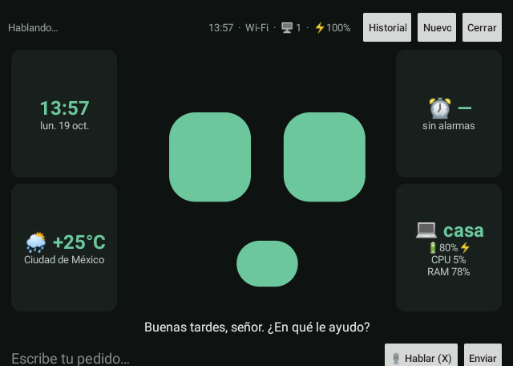
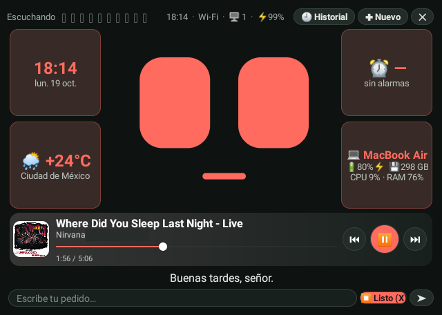
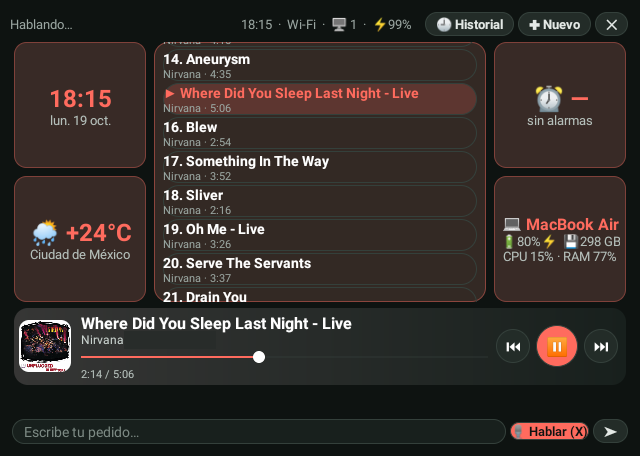
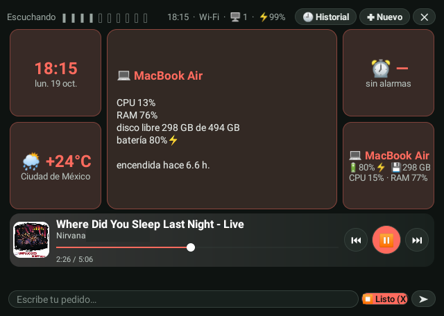

# Monki

**Asistente de voz con cara, estilo mayordomo IA, para la consola Anbernic RG353V (Android 11).**
Lo despiertas con *"hey monki"*, te entiende en español y actúa: contesta lo que sea, busca en internet, maneja la consola, controla tu Mac y tu PC con Windows, pone música en los Echo de la casa y te enseña en pantalla lo que está sonando.

Todo con servicios **gratuitos**. Cuando una API gratis se queda sin cuota, Monki pasa sola a la siguiente, y si no queda ninguna (o no hay internet) responde con un modelo que corre **dentro de la consola**.

> **Estado:** en desarrollo activo. Se usa a diario en una consola real; lo que falta está en [Pendientes](docs/pendientes.md).

<p align="center">
  
</p>

---

## Lo que hace

| Área | Qué puedes pedirle |
|---|---|
| **Conversar** | Cualquier pregunta, en 1 o 2 frases directas. Personalidad de mayordomo con humor seco |
| **Internet** | Búsquedas (DuckDuckGo), leer páginas, clima (wttr.in). Sin gastar cuota de IA |
| **Alarmas en el Echo** | "Pon una alarma mañana a las 7 con Bad Bunny": queda en tu Echo y suena con esa música de Spotify. También las lista y las quita |
| **Tiempo y memoria** | Temporizadores y recordatorios en la consola; recuerda tus datos entre conversaciones |
| **Rutinas** | Frases que hacen varias cosas ("buenas noches"). Se crean y se borran hablando |
| **La consola** | Ve la pantalla, toca, desliza, abre apps y juegos, escribe, volumen, brillo, batería |
| **Mac y Windows** (vía `casa`) | Estado (CPU, RAM, disco, batería), captura, abrir y cerrar apps, teclado y mouse, portapapeles, buscar y abrir archivos, brillo, silencio, bloquear, dormir, reiniciar o apagar (con confirmación), música, avisos |
| **Teles y celulares** (vía `casa`) | Chromecast y YouTube, celulares Android por adb, Wake-on-LAN |
| **Música en los Echo** (vía `casa`) | "Pon música relajante en Spotify", pausa, siguiente, volumen, adelantar. No hace falta decir "Alexa" |

### La cara

- **Ojos y boca animados** con 20 expresiones. La boca se mueve con el volumen real de la voz.
- **Estado de ánimo** que dura entre conversaciones: sube con respuestas alegres, baja con tristes, se cansa de noche o con poca batería y se aburre si no le hablas.
- **Color configurable** por voz ("ponte azul"), en ajustes, o *según su ánimo*.
- **Ánimo según la música:** cuando cambia la canción, decide si es bailable, alegre, tranquila, triste o pesada; la cara toma ese ánimo y su color, y se mece si la canción es alegre.

<p align="center">
  
  <br><sub>Feliz, emocionado, triste, molesto, cansado y aburrido, con el color "según su ánimo".</sub>
</p>

### La pantalla

<p align="center">
  
</p>

- **Widgets** a los lados de la cara: hora y fecha, clima, próxima alarma (del Echo, con su música) y cada computadora conectada con su modelo, batería, disco, CPU y RAM. **Toman el color del ánimo.**
- **Toca un widget** (o selecciónalo con la cruceta y presiona A) y su detalle aparece en el lugar de la cara: estado de la consola, clima y pronóstico, todas las alarmas o la información completa de la computadora.
- **Reproductor:** si suena algo en un Echo aparece con la portada, el fondo del color de la portada, la canción, una **barra de avance que puedes arrastrar** (o mover con la cruceta) para adelantar o regresar, y botones redondos ⏮ ⏯ ⏭.
- **Botones de volumen de la consola:** con el panel abierto y música sonando, suben y bajan el volumen del Echo.
- **Toca el reproductor** y aparece la lista de canciones de lo que suena, con la actual marcada; toca otra y se la pide al Echo.
- Botones en forma de píldora; al escribir con el teclado aparece **"← Volver"**.

<p align="center">
  
  
</p>

<p align="center">
  
</p>

---

## Cerebro: varias IA gratis en cadena

```
pedido ─► Groq ──► NVIDIA ──► OpenRouter ──► Gemini ──► modelo local (en la consola)
          rápido   más cupo   emergencia     ve imágenes  sin internet ni límites
```

- **Groq** (`gpt-oss-120b`, `qwen3.8-27b`, `gpt-oss-20b`) contesta primero: ~1.5 s.
- **Gemini** va primero solo cuando Monki necesita *ver* la pantalla (es el único que entiende imágenes).
- Si un proveedor responde 429, 413, 404, 410 o tarda de más, pasa al siguiente modelo y luego al siguiente proveedor.
- **Modelo local:** Qwen2.5-0.5B con [llama.cpp](https://github.com/ggml-org/llama.cpp) compilado dentro de la app. Conversa sin internet (~8 s por respuesta), pero no usa herramientas.

Para entender tu voz usa **Whisper** de Groq (~1 s), con Gemini de respaldo.

### ¿Y si la computadora está apagada?

Monki vive en la consola y **no depende de la Mac** para lo esencial:

| Funciona sin la Mac | Necesita `casa` encendido |
|---|---|
| "Hey monki", respuestas (Groq, NVIDIA, Gemini o el modelo local), internet, clima | Voz de Edge (se usa Gemini o la voz sin internet) |
| Voz con Gemini o Piper sin internet | Música, alarmas y volumen de los Echo |
| Temporizadores, recordatorios, rutinas, memoria | Portadas y lista de canciones |
| Cara, ánimo, widgets de hora y clima, control de la consola | Control de la computadora |

Si `casa` no responde, Monki deja de intentar su voz durante 2 minutos para no hacerte esperar.

## Voz

```
Edge (es-MX, generada en la Mac) ─► Gemini TTS ─► Piper sin internet (en la consola)
           ~1.5 s                                          ~3.5 s
```

- La voz neuronal de Microsoft Edge la genera el hub `casa` y la consola solo la reproduce.
- **Pronunciaciones** configurables para nombres que la voz lee mal (`Oscar=Óscar`).
- Monki **nunca dice "Alexa"** en voz alta (la cambia por "la bocina"), para no despertar los Echo de la casa.

---

## Cómo está armado

```
              "hey monki"
                   │
┌──────────────────▼───────────────────────────┐        ┌────────────────────────────────┐
│ Consola RG353V  (asistente-apk, Kotlin)      │  MCP   │ Mac o Windows  (casa, Python)  │
│                                              │ ─────► │                                │
│ Vosk (sin internet) → "hey monki"            │  HTTP  │ casa.py  servidor MCP :8800    │
│ Groq / NVIDIA / Gemini → piensa y usa tools  │ +clave │  ├─ computadora, red, teles    │
│ llama.cpp (Qwen 0.5B) → último respaldo      │        │  ├─ POST /voz  (voz Edge)      │
│ Edge / Gemini / Piper → voz                  │ ◄───── │  └─ alexa/alexa.js :8801 ──────┼──► Echos
│ Accesibilidad → ve y toca la pantalla        │  voz   │     (solo 127.0.0.1)           │
└──────────────────────────────────────────────┘        └────────────────────────────────┘
```

| Carpeta | Qué es |
|---|---|
| [`asistente-apk/`](asistente-apk) | App Android en Kotlin: Monki en la consola (incluye llama.cpp como submódulo) |
| [`casa/`](casa) | Hub MCP en Python (FastMCP) para Mac o Windows, voz Edge y puente de Alexa en Node |
| [`agente/`](agente) | Versión de escritorio: el agente corre en la Mac y maneja la consola por adb |
| [`herramientas/`](herramientas) | Descarga del modelo Vosk y scripts para analizar el reconocimiento de voz |
| [`configuracion/`](configuracion) | Plantillas de LaunchAgent (macOS) y controles de PPSSPP |
| [`docs/`](docs) | [Arquitectura](docs/arquitectura.md), [configuración](docs/configuracion.md), [problemas conocidos](docs/problemas-conocidos.md), [pendientes](docs/pendientes.md) |

---

## Instalación

**Necesitas:** una consola Android 11 con depuración USB (probado en RG353V), una Mac con Homebrew (o una PC con Windows para `casa`) y claves **gratis** de [Groq](https://console.groq.com/keys), [NVIDIA](https://build.nvidia.com) y/o [Gemini](https://aistudio.google.com/apikey). Con una basta; con varias, Monki casi nunca se queda sin respuesta.

### 1. App en la consola

```bash
git clone --recursive https://github.com/Niicko12/monki.git    # --recursive trae llama.cpp
cd monki
herramientas/descargar-modelo-vosk.sh          # modelo de voz para "hey monki" (~58 MB)

cd asistente-apk
export JAVA_HOME=/opt/homebrew/opt/openjdk@17
export ANDROID_HOME=/opt/homebrew/share/android-commandlinetools
"$ANDROID_HOME"/cmdline-tools/latest/bin/sdkmanager "ndk;27.2.12479018" "cmake;3.22.1"
./gradlew assembleDebug
adb install -r app/build/outputs/apk/debug/app-debug.apk

# Permiso para prender y apagar el servicio de toques (ver docs/problemas-conocidos.md)
adb shell pm grant com.limber.asistente android.permission.WRITE_SECURE_SETTINGS

# Tus claves, tu nombre y tu ciudad (se guardan solo en la consola)
adb shell "am start -f 0x10008000 -n com.limber.asistente/.MainActivity \
  --es groq_key 'TU_CLAVE_GROQ' --es nvidia_key 'TU_CLAVE_NVIDIA' --es key 'TU_CLAVE_GEMINI' \
  --es user_name 'Tu nombre' --es location 'Tu ciudad, Estado, País'"
```

En la consola: **Ajustes → Accesibilidad → Monki → activar**, y dale permiso de micrófono.

### 2. Modelo local (opcional, recomendado)

```bash
curl -L -o qwen.gguf https://huggingface.co/Qwen/Qwen2.5-0.5B-Instruct-GGUF/resolve/main/qwen2.5-0.5b-instruct-q4_0.gguf
adb push qwen.gguf /data/local/tmp/llm.gguf
adb shell "run-as com.limber.asistente sh -c 'mkdir -p files && cp /data/local/tmp/llm.gguf files/llm.gguf'"
adb shell rm /data/local/tmp/llm.gguf
```

### 3. Voz sin internet (opcional)

Instala el motor [sherpa-onnx](https://k2-fsa.github.io/sherpa/onnx/tts/apk-engine.html) con la voz `es_MX-ald-medium` (arm64) y ponlo como motor del sistema.

### 4. Hub `casa` en la computadora (opcional)

```bash
cd casa
uv run casa.py      # la primera vez crea .env con CASA_TOKEN
```

- **macOS:** arranque automático con la plantilla `configuracion/launchd/com.limber.casa.plist` (lanza el Python del `.venv` directamente; con `uv run` en medio, al reiniciar quedaba un proceso viejo con el puerto ocupado). Para que Monki use el teclado y el mouse, da permiso de *Accesibilidad* a `uv`/`python`.
- **Windows:** `powershell -ExecutionPolicy Bypass -File .\instalar-windows.ps1` como administrador; al final imprime la línea para la consola.

Conecta Monki al hub:

```bash
adb shell "am start -f 0x10008000 -n com.limber.asistente/.MainActivity --es mcp_servers 'casa|http://IP_DE_LA_MAC:8800/mcp|CASA_TOKEN'"
```

### 5. Echo de Alexa (opcional, no oficial)

```bash
cd casa/alexa && npm install && ALEXA_PRINCIPAL="Nombre de tu Echo" node alexa.js
```

Abre `http://127.0.0.1:3456` en la Mac e inicia sesión en Amazon. Usa [alexa-remote2](https://github.com/Apollon77/alexa-remote), que no es oficial y puede dejar de funcionar si Amazon cambia algo.

Todos los ajustes están en [docs/configuracion.md](docs/configuracion.md).

---

## Doble sistema: dArkOS en la SD

Si quieres un sistema de juegos tipo ArkOS sin perder Android (ni a Monki): graba [dArkOS](https://github.com/christianhaitian/dArkOS/releases) para RG353V en una SD (con Raspberry Pi Imager; `dd` desde la terminal de macOS no tiene permiso) y ponla en **TF1**. Con la SD puesta arranca dArkOS; sin ella, Android con Monki. La tarjeta de juegos va en TF2: en dArkOS, *Options → Advanced → Switch to SD2 for Roms*, y espera a que termine sin reiniciar.

> ROCKNIX actual no sirve aquí: su Linux *mainline* solo arranca si borras el Android interno.

## Uso

- **"hey monki"** o el botón **X**: escucha. **B** interrumpe. Mientras habla también lo cortas con "hey monki".
- Ejemplos: *"¿cómo estará el clima mañana?"*, *"pon una alarma a las 7 con Metallica"*, *"¿qué alarmas tengo?"*, *"pon un temporizador de 10 minutos"*, *"abre PPSSPP"*, *"pon música relajante en Spotify"*, *"siguiente canción"*, *"¿cómo está mi Mac?"*, *"cierra Chrome en la Mac"*, *"ponte morado"*, *"buenas noches"*.
- Llámalo con **"hey monki"**: el nombre solo, sin "hey", solo lo despierta si se entiende muy claro (así no se activa con la tele o los juegos).
- Rutinas por voz: *"crea una rutina 'a jugar' que suba el brillo a 80 y abra PPSSPP"*.

## Privacidad y secretos

- Las claves de API, tu nombre, tu ciudad y los servidores se guardan **solo en la consola** (preferencias de la app), nunca en el código.
- `casa/.env` (clave del hub), `casa/alexa/alexa-cookie.json` (sesión de Amazon), logs, modelos y APKs están en `.gitignore`. **No los subas ni los compartas.**
- El hub `casa` exige su clave en cada petición y el puente de Alexa solo escucha en `127.0.0.1`.

## Problemas conocidos

Lo aprendido a golpes está en [docs/problemas-conocidos.md](docs/problemas-conocidos.md). Lo más importante:

- Un servicio de accesibilidad con permiso de gestos rompe la cruceta y el stick en los emuladores.
- El micrófono trae un zumbido de 60/180 Hz casi tan fuerte como la voz: hay que filtrarlo para saber cuándo terminaste de hablar.
- El reproductor de Rockchip se traba si se le cambia la velocidad.
- Las cuotas gratis se acaban rápido: por eso la cadena de proveedores y el modelo local.

## Créditos y licencias

- [llama.cpp](https://github.com/ggml-org/llama.cpp) (MIT) y [Qwen2.5](https://huggingface.co/Qwen/Qwen2.5-0.5B-Instruct-GGUF) (Apache 2.0): modelo local.
- [Vosk](https://alphacephei.com/vosk/) (Apache 2.0): palabra de activación sin internet.
- [sherpa-onnx](https://github.com/k2-fsa/sherpa-onnx) y [Piper](https://github.com/rhasspy/piper): voz sin internet.
- [edge-tts](https://github.com/rany2/edge-tts): voz neuronal de Microsoft Edge.
- [MCP Python SDK](https://github.com/modelcontextprotocol/python-sdk), [alexa-remote2](https://github.com/Apollon77/alexa-remote), [PyChromecast](https://github.com/home-assistant-libs/pychromecast), [PyAutoGUI](https://github.com/asweigart/pyautogui).
- Inspirado en [xiaozhi-esp32](https://github.com/78/xiaozhi-esp32).

Código bajo licencia [MIT](LICENSE).
